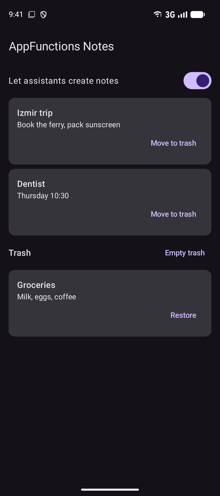

# AppFunctions Notes

A small Android notes app that exposes four functions to Gemini and other on-device agents with
[Jetpack AppFunctions](https://developer.android.com/ai/appfunctions). It's the companion code for my
Medium guide on AppFunctions, and everything in it runs without an API key or a Google account.



## What's inside

- `appfunctions/BaseNotesAppFunctionService.kt`: the four functions. `createNote` and `searchNotes`
  are open to agents, `moveNoteToTrash` is reversible, and `emptyTrash` is limited to the app itself
  with `@AppFunctionAccessLevel`.
- `appfunctions/Note.kt`: the `@AppFunctionSerializable` type the functions return.
- `appfunctions/AppFunctionSwitch.kt`: a runtime kill switch for `createNote`, wired to the toggle
  at the top of the screen.
- `res/xml/app_metadata.xml`: app-level instructions for agents.
- `data/Notes.kt`: a plain Room database. Retried creates don't make duplicates.
- `scripts/af.sh`: a tiny helper for calling the functions from your laptop with adb.
- Tests: Robolectric tests with `AppFunctionTestRule` (they run on the JVM and in CI) and an
  instrumented test that calls the functions through `AppFunctionManager` on a device.

## Requirements

- Android Studio with AGP 9.5 or newer. The AppFunctions AAR needs compileSdk 37 and AGP 9.1+.
- To call the functions: an emulator or device on Android 16 QPR2 (API 36.1) or newer. The app
  installs on API 26+, but the functions only run on API 36+. On the very first Android 16 image,
  `cmd app_function` didn't work at all, so use a 36.1 image.

## Try it

```bash
./gradlew installDebug
adb shell cmd app_function list-app-functions | grep -o '"dev\.omerdurmaz\.notes[^"]*#[^"]*"' | sort -u

source scripts/af.sh
af createNote '{"title": "Groceries", "content": "Milk, eggs, coffee"}'
af createNote '{"title": "Groceries", "content": "Milk, eggs, coffee"}' --brief-yaml  # same noteId
af searchNotes '{"query": "milk"}' --brief-yaml
af searchNotes '{"query": " "}'  # error code 1001 with a hint for the caller
af emptyTrash '{}'               # refused with code 1000: only the app itself may call it
```

Open the app and the note is there. Turn off "Let assistants create notes" and `createNote` starts
failing with code 1002. You can do the same from adb:

```bash
adb shell cmd app_function set-enabled --package dev.omerdurmaz.notes \
  --function 'dev.omerdurmaz.notes.appfunctions.BaseNotesAppFunctionService#createNote' \
  --state disable   # later: --state default
```

With more than one device attached, set `ANDROID_SERIAL` before running these.

## Tests

```bash
./gradlew testDebugUnitTest            # JVM, no device needed
./gradlew connectedDebugAndroidTest    # needs an API 36.1+ emulator or device
```

## Will Gemini call these functions?

Not yet, unless your app is selected for Google's early access program. As of November 2026 the
Gemini integration is a private preview with trusted testers, and only a limited number of apps and
agents can use the full pipeline. Everything in this repo still runs on your own device today.

## Versions

androidx.appfunctions 1.0.0-rc01, AGP 9.5.1, Gradle 9.9.1, Kotlin 2.4.21, KSP 2.3.14, Room 2.8.5,
Robolectric 4.18. Tested on the Pixel 9 emulator image, Android 16 QPR2 (BE4B.251210.005).

## Türkçe

Jetpack AppFunctions ile Gemini ve diğer cihaz içi agent'lara dört fonksiyon açan küçük bir not
uygulaması. Medium'daki AppFunctions rehberimin örnek kodu. API anahtarı ya da Google hesabı
gerekmiyor. Fonksiyonları çağırmak için Android 16 QPR2 (API 36.1) veya daha yeni bir emülatör
kullanın. Komutlar yukarıdaki "Try it" bölümünde. Gemini entegrasyonu şu an yalnızca Google'ın
seçtiği uygulamalara açık, ama buradaki her şey kendi cihazınızda bugün çalışıyor.

## License

Apache 2.0. See [LICENSE](LICENSE).
